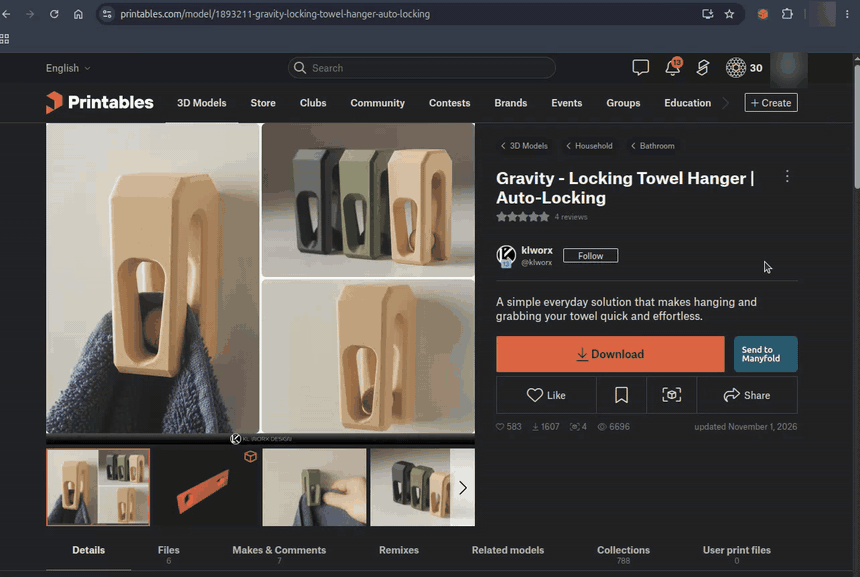

# Send To Manyfold

A Chrome and Firefox extension that sends 3D models from Printables, Thingiverse, MakerWorld and Voron Mods to your own [Manyfold](https://manyfold.app) library. It uploads the files and fills in the details (title, description, creator, license, tags, source link, cover image) for you.

Not affiliated with or endorsed by Manyfold, Printables, Thingiverse, MakerWorld or Voron Mods. Those names are trademarks of their respective owners and are used here only to say which services this works with.

> Status: version 0.1.2, available on the [Chrome Web Store](https://chromewebstore.google.com/detail/send-to-manyfold/ebbpcpaiebehbkdeopjclobhadoofjcb). Firefox: coming to addons.mozilla.org; until then, install from source. The Firefox build is newer and has had less real-world use than the Chrome one. Tested with automated tests and in real use with Manyfold. See [Known limitations](#known-limitations).



## What it does

Open a model page, click the toolbar icon (or the green "Send to Manyfold" button where the page has one), check the prefilled details, pick the files and a collection, and press Send. Apart from a read-only check of whether the page is already in your Manyfold, nothing is sent until you press Send.

| Site | Pages | What happens |
|---|---|---|
| Printables | model pages (`/model/...`) | Downloads the files and uploads them to Manyfold. |
| MakerWorld | model pages (`/models/...`) | Downloads the files and uploads them to Manyfold. |
| Voron Mods | mod pages (`/details/...`) | Downloads the mod's zip and uploads it to Manyfold. |
| Thingiverse | thing pages (`/thing:...`) | Does not upload files. The popup shows the details and hands the page over to Manyfold's own Thingiverse importer. This needs a Thingiverse App Token set in Manyfold: (1) create an app at https://www.thingiverse.com/developers/my-apps; (2) click the "Create & Get App Key" button at the top right (it is white on white until you hover over it); (3) paste the App Token into Manyfold under Settings → Integrations. |

On any other page the popup says the page is not supported and sends nothing.

GitHub support is planned. [Tell us what you'd expect it to do](https://github.com/jackalopes/send-to-manyfold/issues/3).

## Requirements

- Chrome 127 or newer, or Firefox 147.0 or newer.
- A Manyfold server, version 0.147.0 or newer (0.153.0 is the version it was tested against), with a library set up.
- The Manyfold user that owns your token must be allowed to upload: the "contributor" role or higher. A plain member gets "not found" (404) on uploads.
- The library folder must be writable by the user the Manyfold container runs as (uid 1000). If it is not, uploaded ZIP files are never extracted and the send appears to hang until it times out.

## Install from the Chrome Web Store

Install [Send To Manyfold from the Chrome Web Store](https://chromewebstore.google.com/detail/send-to-manyfold/ebbpcpaiebehbkdeopjclobhadoofjcb).

## Install from source

You need Node 22.18 or newer (`.nvmrc` says 22; `engines` makes npm warn on older versions; it is enforced only with `engine-strict`).

```
npm ci
npm run build
```

Then open `chrome://extensions`, turn on Developer mode, choose "Load unpacked" and select the `.output/chrome-mv3` folder.

`npm run zip` also writes a ZIP of the build to `.output/`.

### Firefox

```
npm ci
npm run build:firefox
```

Then open `about:debugging#/runtime/this-firefox`, choose "Load Temporary Add-on" and select `.output/firefox-mv3/manifest.json`. A temporary add-on is removed when Firefox closes.

`npm run zip:firefox` writes the extension ZIP and a sources ZIP (for addons.mozilla.org review) to `.output/`. `npm run lint:firefox` runs `web-ext lint` on the build; it leaves one warning, about Preact's `innerHTML` assignment in the bundled library.

## Create a Manyfold token

The extension talks to Manyfold with a long-lived access token that you create once.

1. Sign in to Manyfold as the user who should own the uploads.
2. Open `<your Manyfold address>/oauth/applications`. Manyfold calls this page "API keys".
3. Choose "New API key". Give it a name and the scopes `read`, `write` and `upload`. Save it.
4. On the key's page, choose "New Access Token" (under "Access Tokens"). Select the same three scopes and an expiry (7 days, 4 weeks, 3 months or 6 months), then submit.
5. Reveal the token and copy it. It is shown only once.

Scopes: `read` is used to test the connection and list collections, `write` to create and update the model, `upload` to upload files.

The token expires, so you will need to create a new one when it does.

## Settings

Open the extension's options page (right-click the toolbar icon, then Options).

- Manyfold address and token. Saving asks the browser for permission to talk to that address. In Chrome that is the one address you typed; in Firefox it is that host on any port, because Firefox does not apply a port-specific grant to cross-origin requests.
  An address typed without `http://` or `https://` is treated as `https://`, except IP addresses, `localhost` and `.local`, `.lan`, `.home.arpa` and `.internal` names, which get `http://`. For a plain LAN name served over http, such as `nas:3214`, type the scheme: `http://nas:3214`.
  Plain `http://` is allowed because self-hosted servers on home networks often have no TLS certificate. The token is sent only to the address you typed. The options page warns when an `http://` address points at a public host. Use `https://` whenever your server has it.
- "Test connection". When Manyfold does not tell tokens its version, this says just "Connected." That is expected. Version 0.147.0 or newer is still required.
- Which fields to prefill: title, description, creator, license, tags, source link, images.
- Include preview images.
- Printer tags, per site: On, Off or Ask. Voron Mods marks each mod with the printers it fits (Voron 2.4, Voron Trident and so on). Its default is Ask: the popup suggests "Add printer tags: ..." and you choose. Clicking the suggestion saves On for Voron Mods; "Not this time" skips the tags for that send only. You can change it later on the options page.
- A default collection and a default "sensitive" flag.

## Privacy

The full policy is at <https://jackalopes.github.io/send-to-manyfold/privacy/>.

- The extension talks only to the source site you are on and its download and image hosts, and to your own Manyfold server. It reads the model page and resolves download links using your logged-in session in the page; the files are then downloaded without your cookies.
- No analytics, no tracking, no other servers.
- Your Manyfold address and token are stored in the browser's local extension storage (`chrome.storage.local`, also used by Firefox) on your computer.
- The extension never reads or copies the login tokens of the source sites.
- The only automatic request is a read-only check, sent to your own Manyfold, of whether the model page you're on is already saved (a search by the page's link, so it can show a check). Nothing else is sent until you press Send. On the three supported sites the toolbar icon is greyed out on other pages; on a model page that is already in your Manyfold it shows a green check badge, and the button on the page reads "✓ In Manyfold" and opens the model.

## Site terms and model licenses

The extension downloads models only when you tell it to. It sends one model at a time, when you press Send, using your own session on the site. It does not crawl sites or download in bulk.

You are responsible for how you use it. Each site has its own terms of use, and some restrict automated access or copying, so read the terms of any site you use it with. Each model also has its own license, which still applies to the copy in your library. The extension is provided as is, without warranty (see [LICENSE](LICENSE)).

If you represent Manyfold or one of these sites and have a concern, please [open an issue](https://github.com/jackalopes/send-to-manyfold/issues).

## Known limitations

- MakerWorld may answer with a bot check partway through a send. Downloading a file by hand on the site, then sending again, has cleared it. See [#2](https://github.com/jackalopes/send-to-manyfold/issues/2).
- The injected buttons depend on each site's page layout and may stop appearing when a site changes. The toolbar icon keeps working.
- Thingiverse files are not uploaded (see above).
- Firefox lets you revoke the extension's host permissions, including the download hosts (`files.printables.com`, `media.printables.com`, `makerworld.bblmw.com`, `mods.vorondesign.com`), in `about:addons`. If you do, sends from that site fail until you grant them again.
- On Firefox the site access for `printables.com`, `thingiverse.com`, `makerworld.com` and `mods.vorondesign.com` can also be revoked in `about:addons`. If you do, there is no injected button and the toolbar icon stays greyed until you grant it again.
- On Firefox, sends run in a hidden page inside the extension's background page, kept alive while a send runs. If Firefox restarts the extension in the middle of a send, that send is lost and you need to send again.
- Files over 1 GiB are not accepted by Manyfold and are disabled in the popup.
- Collections can only be chosen when the model is created.
- Manyfold limits how fast models can be created. Large batches are paced and may wait.
- The Manyfold version check is best-effort (see Settings).
- Updating to the release that adds Voron Mods asks for access to `mods.vorondesign.com`. Chrome turns the extension off until you accept it on the extensions page (or in the prompt). Your settings are kept.

## Development

```
nvm use          # Node 22 (22.18+ required)
npm ci
npm run dev      # WXT dev mode with reload
npm test         # unit tests (Vitest)
npm run lint
npm run typecheck
npm run build
npm run test:built   # builds, then checks the built manifest
npm run icons        # regenerate src/public/icon/*.png after editing assets/brand/icon.svg
npm run test:e2e     # end-to-end test against a throwaway Manyfold
npm run zip
npm run build:firefox   # Firefox MV3 build (.output/firefox-mv3)
npm run zip:firefox
npm run lint:firefox    # web-ext lint of the Firefox build
npm run test:built:firefox
```

`npm run test:e2e` needs Docker. It starts Manyfold 0.153.0, Postgres and Redis in containers (about 2 GB to pull the first time) and removes them afterwards.

Stack: [WXT](https://wxt.dev), Preact, TypeScript, Vitest.

Dependency pins:

- TypeScript 6.0.3: typescript-eslint 8.72.1 accepts TypeScript below 6.1.0 only.
- `@babel/core` 7.x: `@preact/preset-vite` needs a 7.x peer.
- Preact is wired through `@preact/preset-vite` in `wxt.config.ts`, because `@wxt-dev/module-preact` does not exist on npm.
- Node 22.18+: `node e2e/run.ts` needs 22.18 to run TypeScript directly. wxt needs 22 or newer and vitest ^22.12.

## License

[MIT](LICENSE). Copyright (c) 2026 John Mann.
